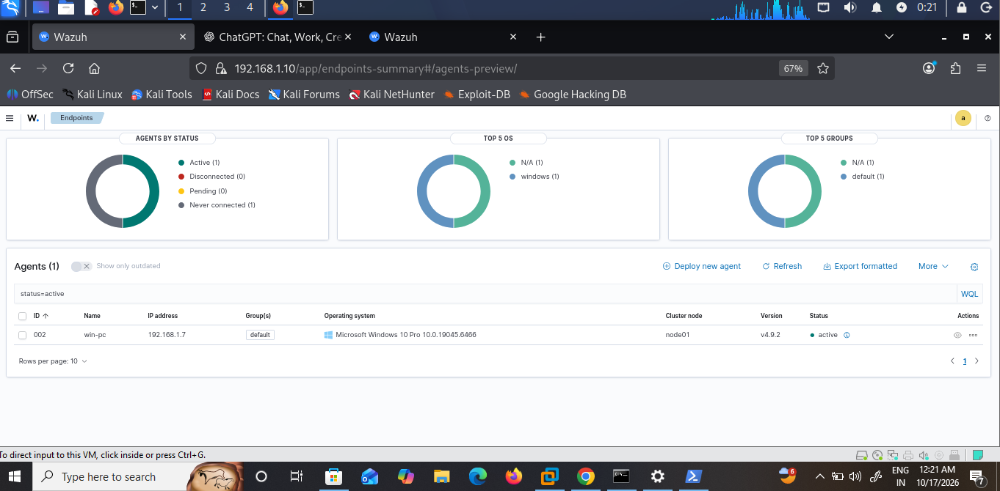
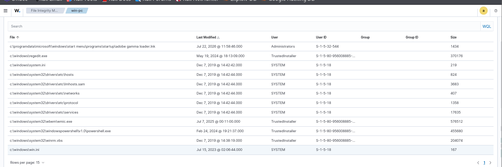
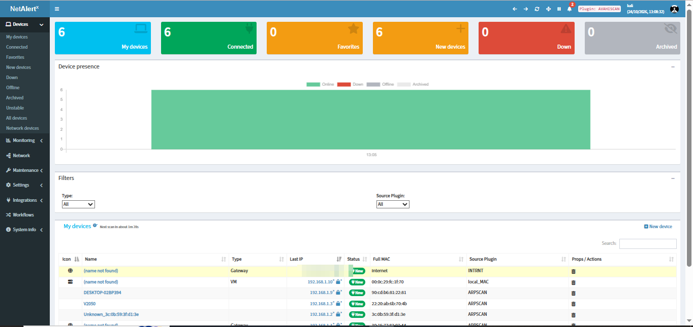
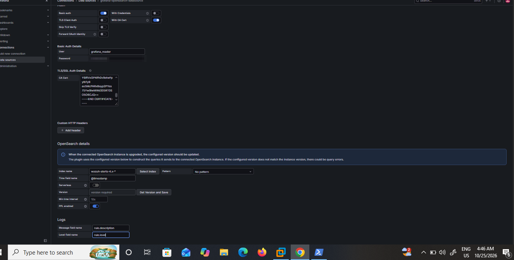
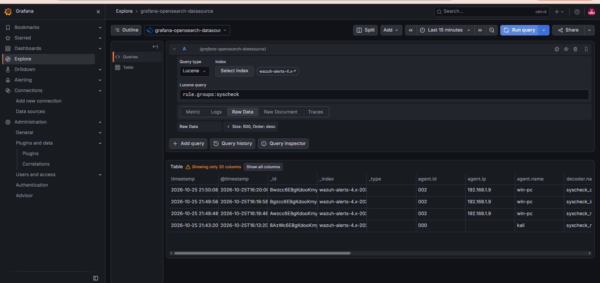
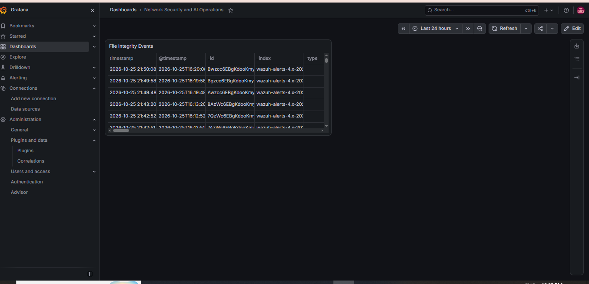

# Home SOC Lab: Wazuh + FIM + NetAlertX + Grafana

A home Security Operations lab that monitors a Windows laptop and a home network, raises alerts on file changes, and visualises them on a hardened Grafana dashboard.

## Architecture
Windows laptop (Wazuh agent, Grafana) <-> Kali VM (Wazuh manager/indexer/dashboard, NetAlertX in Docker) on a bridged home LAN.

Flow: file change on laptop -> agent -> manager rule -> indexer -> Grafana (read-only user, TLS verified).

## What I built
- **Wazuh 4.9.2** all-in-one SIEM, Windows agent enrolled
- **File Integrity Monitoring** (real-time) on a test folder; added / modified / deleted events confirmed
- **NetAlertX** (Docker, ARP scan): network device inventory
- **Hardening:** UFW default-deny with single-IP allow-list, indexer bound to LAN, re-signed certificate with correct SAN, **TLS verification kept ON**, least-privilege read-only Grafana user, container capabilities dropped
- **Grafana** dashboard "Network Security and AI Operations" with an FIM events panel
- **Incident write-up:** [docs/incident-01-fim-new-binary.md](docs/incident-01-fim-new-binary.md)

## Screenshots
| | |
|---|---|
|  |  |
| Agent active | FIM inventory |
|  |  |
| NetAlertX devices | Grafana data source, TLS verify on |
|  |  |
| FIM events in Explore | Dashboard panel |

## Troubleshooting I solved
Container capability errors, YAML duplicate keys, certificate SAN mismatch (re-signed with same key), Wazuh indexer password policy, shell-specific password prompts, noisy registry FIM events.

## Repo contents
`configs/` sanitised configs (placeholders only) | `docs/` incident write-up | `screenshots/`

## Roadmap
SSH brute-force simulation mapped to MITRE ATT&CK, NetAlertX panel in Grafana, optional AI alert summarisation.

> No secrets are committed. All IPs/passwords/tokens are placeholders.
